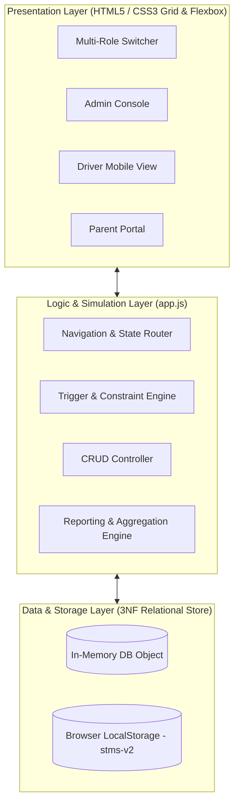
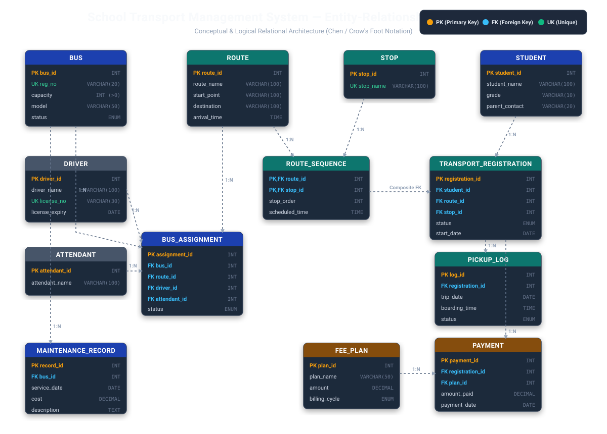
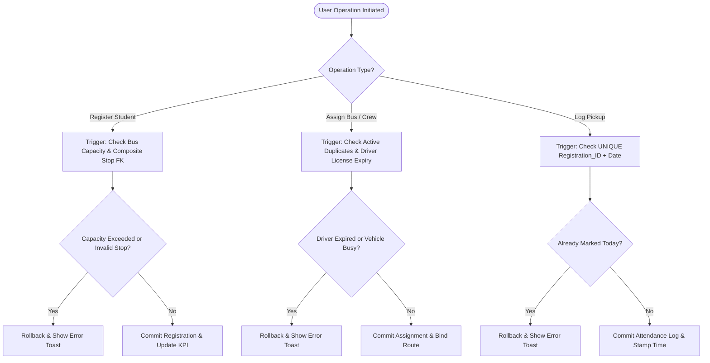

# 🚌 School Transport Management System (DBMS Project Prototype)

[](https://opensource.org/licenses/MIT)
[-success?style=for-the-badge&logo=github)](https://gudavallijagadeesh28.github.io/school-transport-dbms/)
[](index.html)
[](#-database-design--relational-schema-3nf)

> ### 🌐 Live Deployed Application
> **🚀 Access the Live Web App:** [https://gudavallijagadeesh28.github.io/school-transport-dbms/](https://gudavallijagadeesh28.github.io/school-transport-dbms/)
>
> ### 🎓 Student & Academic Project Information
> | Field | Details |
> | :--- | :--- |
> | **Student Name** | **Gudavalli Jagadeesh** |
> | **Roll Number** | **25WU0102090** |
> | **Section / Cohort** | **AIML Rhinos** (AI & Machine Learning) |
> | **Course** | **Database Management Systems (DBMS / DBMS PBL)** |
> | **GitHub Profile** | **[@GudavalliJagadeesh28](https://github.com/GudavalliJagadeesh28)** |
> | **Live Demo URL** | **[https://gudavallijagadeesh28.github.io/school-transport-dbms/](https://gudavallijagadeesh28.github.io/school-transport-dbms/)** |
> | **Project Repository** | **[school-transport-dbms](https://github.com/GudavalliJagadeesh28/school-transport-dbms)** |

A modern, responsive, multi-role web prototype engineered for the **School Transport Route & Student Pickup Management System** DBMS curriculum. This project translates relational database theories (normalization, 3NF schemas, foreign key relationships, triggers, and transactional integrity constraints) into a reactive, interactive front-end application with client-side database simulation and persistent storage.

---

## 📑 Table of Contents
1. [Project Overview & Objectives](#-project-overview--objectives)
2. [System Architecture & Design](#-system-architecture--design)
3. [Entity-Relationship (ER) Diagram](#-entity-relationship-er-diagram)
4. [Relational Schema & Table Definitions (3NF)](#-relational-schema--table-definitions-3nf)
5. [Database Triggers & Business Constraints](#-database-triggers--business-constraints)
6. [Detailed Step-by-Step Module Walkthrough](#-detailed-step-by-step-module-walkthrough)
   - [6.1 Multi-Role Portal Switcher](#61-multi-role-portal-switcher)
   - [6.2 Transport Overview Dashboard](#62-transport-overview-dashboard)
   - [6.3 Routes & Ordered Stops Sequence Builder](#63-routes--ordered-stops-sequence-builder)
   - [6.4 Master Data Management](#64-master-data-management)
   - [6.5 Bus & Crew Assignment Portal](#65-bus--crew-assignment-portal)
   - [6.6 Student Registration & Capacity Validation](#66-student-registration--capacity-validation)
   - [6.7 Fees, Invoicing & Payment Ledger](#67-fees-invoicing--payment-ledger)
   - [6.8 Fleet Maintenance Records](#68-fleet-maintenance-records)
   - [6.9 Analytical DBMS Queries & Reports](#69-analytical-dbms-queries--reports)
   - [6.10 Interactive Constraint Rule Tests](#610-interactive-constraint-rule-tests)
   - [6.11 Driver Companion Portal (Daily Boarding Register)](#611-driver-companion-portal-daily-boarding-register)
   - [6.12 Parent & Student Tracking View](#612-parent--student-tracking-view)
7. [Local State & Storage Persistence](#-local-state--storage-persistence)
8. [Step-by-Step Execution Guide](#-step-by-step-execution-guide)
9. [Project Directory Structure](#-project-directory-structure)

---

## 🎯 Project Overview & Objectives

Transport management in educational institutions faces logistical and safety challenges:
- **Overcrowding & Safety Violations:** Vehicles transporting more passengers than legal seating capacities.
- **Safety & Compliance Gaps:** Unmonitored expiration of driver commercial licenses and skipped maintenance schedules.
- **Lack of Parent Visibility:** Parents left without accurate arrival estimates, driver contact details, or real-time boarding confirmations.
- **Financial Leakage:** Uncollected term fees, manual ledger discrepancies, and absent defaulter tracking.

### Core DBMS Academic Objectives:
- Model a normalized database schema in **Third Normal Form (3NF)** eliminating data redundancies and update anomalies.
- Enforce strict relational constraints: Primary Keys (PK), Unique Keys (UK), Composite Foreign Keys (FK), and Check Constraints (CHECK).
- Simulate MySQL database triggers directly on data manipulation operations (preventing over-capacity registration, blocking assignments with expired licenses, eliminating duplicate daily attendance logs).
- Provide analytical queries to fulfill Review 2 & 3 DBMS evaluation criteria.

---

## 🏗️ System Architecture & Design

The prototype implements a client-side architecture where the JavaScript runtime acts as an in-memory Relational Database Management System (RDBMS) paired with browser `localStorage` as its persistent disk storage engine.



---

## 📊 Entity-Relationship (ER) Diagram

The following Chen/Crow's Foot Entity-Relationship diagram illustrates all database entities, their primary/foreign key attributes, and the relationship cardinalities between them:

```mermaid
erDiagram
    BUS ||--o{ BUS_ASSIGNMENT : "allocated in"
    ROUTE ||--o{ BUS_ASSIGNMENT : "operated by"
    DRIVER ||--o{ BUS_ASSIGNMENT : "piloted by"
    ATTENDANT ||--o{ BUS_ASSIGNMENT : "staffed by"
    BUS ||--o{ MAINTENANCE_RECORD : "incurs"
    ROUTE ||--|{ ROUTE_SEQUENCE : "comprises"
    STOP ||--o{ ROUTE_SEQUENCE : "is included in"
    STUDENT ||--o{ TRANSPORT_REGISTRATION : "submits"
    ROUTE ||--o{ TRANSPORT_REGISTRATION : "assigned to"
    STOP ||--o{ TRANSPORT_REGISTRATION : "pickup point"
    TRANSPORT_REGISTRATION ||--o{ PAYMENT : "bills"
    FEE_PLAN ||--o{ PAYMENT : "defines rates for"
    TRANSPORT_REGISTRATION ||--o{ PICKUP_LOG : "tracked by"

    BUS {
        int id PK
        string reg UK "Vehicle registration number"
        int cap "Seating capacity > 0"
        string model "Bus make and model"
        string status "ACTIVE or MAINTENANCE"
    }

    STOP {
        int id PK
        string name "Designated stop landmark"
    }

    ROUTE {
        int id PK
        string name "Route designation"
        string start "Origin landmark"
        string end "School campus destination"
        string arr "Scheduled school arrival time"
    }

    ROUTE_SEQUENCE {
        int route_id FK "References ROUTE(id)"
        int stop_id FK "References STOP(id)"
        string arrival_time "Scheduled stop time"
        int sequence_order "Sequential order on route"
    }

    DRIVER {
        int id PK
        string name "Driver full name"
        string lic UK "Driving license number"
        date exp "License expiration date"
    }

    ATTENDANT {
        int id PK
        string name "Safety attendant name"
    }

    BUS_ASSIGNMENT {
        int id PK
        int bus_id FK "References BUS(id)"
        int route_id FK "References ROUTE(id)"
        int drv_id FK "References DRIVER(id)"
        int att_id FK "References ATTENDANT(id)"
        string status "ACTIVE or ENDED"
    }

    STUDENT {
        int id PK
        string name "Student full name"
        string grade "Class or Grade level"
        string contact "Parent phone number"
    }

    TRANSPORT_REGISTRATION {
        int id PK
        int student_id FK "References STUDENT(id)"
        int route_id FK "References ROUTE(id)"
        int stop_id FK "References STOP(id)"
        string status "ACTIVE or INACTIVE"
        date start_date "Enrollment date"
    }

    FEE_PLAN {
        int id PK
        string name "Billing plan name"
        int amt "Fee tariff amount"
        string cycle "Monthly, Quarterly, or Yearly"
    }

    PAYMENT {
        int id PK
        int reg_id FK "References TRANSPORT_REGISTRATION(id)"
        int plan_id FK "References FEE_PLAN(id)"
        int amt "Amount paid in INR"
        date payment_date "Transaction date"
    }

    PICKUP_LOG {
        int id PK
        int reg_id FK "References TRANSPORT_REGISTRATION(id)"
        date trip_date "Trip calendar date"
        string time "Actual boarding time"
        string status "PICKED_UP, LATE, or ABSENT"
    }

    MAINTENANCE_RECORD {
        int id PK
        int bus_id FK "References BUS(id)"
        date service_date "Workshop service date"
        int cost "Repair expenditure"
        string desc "Service description"
    }
```

<p align="center">
  
</p>



---

## 🗄️ Relational Schema & Table Definitions (3NF)

All relations are normalized to **3NF** to prevent Insertion, Deletion, and Modification anomalies. Below are the schema specifications:

### 1. `BUS`
Holds physical vehicle records and capacity limits.
```sql
CREATE TABLE BUS (
    Bus_ID INT PRIMARY KEY AUTO_INCREMENT,
    Registration_No VARCHAR(20) NOT NULL UNIQUE,
    Capacity INT NOT NULL CHECK (Capacity > 0),
    Model VARCHAR(50) NOT NULL,
    Status ENUM('ACTIVE', 'MAINTENANCE') DEFAULT 'ACTIVE'
);
```

### 2. `STOP`
Master directory of physical transit pickup and drop-off points.
```sql
CREATE TABLE STOP (
    Stop_ID INT PRIMARY KEY AUTO_INCREMENT,
    Stop_Name VARCHAR(100) NOT NULL UNIQUE
);
```

### 3. `ROUTE`
Transit route headers with terminal destination and school arrival target.
```sql
CREATE TABLE ROUTE (
    Route_ID INT PRIMARY KEY AUTO_INCREMENT,
    Route_Name VARCHAR(100) NOT NULL,
    Start_Point VARCHAR(100) NOT NULL,
    Destination VARCHAR(100) NOT NULL DEFAULT 'School Campus',
    Arrival_Time TIME NOT NULL
);
```

### 4. `ROUTE_SEQUENCE`
Normalized bridge table representing the ordered itinerary of stops along each route (eliminating repeating groups).
```sql
CREATE TABLE ROUTE_SEQUENCE (
    Route_ID INT NOT NULL,
    Stop_ID INT NOT NULL,
    Stop_Order INT NOT NULL,
    Scheduled_Time TIME NOT NULL,
    PRIMARY KEY (Route_ID, Stop_ID),
    FOREIGN KEY (Route_ID) REFERENCES ROUTE(Route_ID) ON DELETE CASCADE,
    FOREIGN KEY (Stop_ID) REFERENCES STOP(Stop_ID)
);
```

### 5. `DRIVER`
Licensed transport crew members.
```sql
CREATE TABLE DRIVER (
    Driver_ID INT PRIMARY KEY AUTO_INCREMENT,
    Driver_Name VARCHAR(100) NOT NULL,
    License_No VARCHAR(30) NOT NULL UNIQUE,
    License_Expiry DATE NOT NULL
);
```

### 6. `ATTENDANT`
On-board child safety chaperones.
```sql
CREATE TABLE ATTENDANT (
    Attendant_ID INT PRIMARY KEY AUTO_INCREMENT,
    Attendant_Name VARCHAR(100) NOT NULL
);
```

### 7. `BUS_ASSIGNMENT`
Relational allocation binding vehicle, driver, attendant, and route together.
```sql
CREATE TABLE BUS_ASSIGNMENT (
    Assignment_ID INT PRIMARY KEY AUTO_INCREMENT,
    Bus_ID INT NOT NULL,
    Route_ID INT NOT NULL,
    Driver_ID INT NOT NULL,
    Attendant_ID INT NOT NULL,
    Status ENUM('ACTIVE', 'ENDED') DEFAULT 'ACTIVE',
    FOREIGN KEY (Bus_ID) REFERENCES BUS(Bus_ID),
    FOREIGN KEY (Route_ID) REFERENCES ROUTE(Route_ID),
    FOREIGN KEY (Driver_ID) REFERENCES DRIVER(Driver_ID),
    FOREIGN KEY (Attendant_ID) REFERENCES ATTENDANT(Attendant_ID)
);
```

### 8. `STUDENT`
Student directory independent of transport subscription.
```sql
CREATE TABLE STUDENT (
    Student_ID INT PRIMARY KEY AUTO_INCREMENT,
    Student_Name VARCHAR(100) NOT NULL,
    Grade VARCHAR(10) NOT NULL,
    Contact_No VARCHAR(20) NOT NULL
);
```

### 9. `TRANSPORT_REGISTRATION`
Subscriptions linking students to designated routes and specific boarding stops.
```sql
CREATE TABLE TRANSPORT_REGISTRATION (
    Registration_ID INT PRIMARY KEY AUTO_INCREMENT,
    Student_ID INT NOT NULL,
    Route_ID INT NOT NULL,
    Stop_ID INT NOT NULL,
    Status ENUM('ACTIVE', 'INACTIVE') DEFAULT 'ACTIVE',
    Start_Date DATE NOT NULL,
    FOREIGN KEY (Student_ID) REFERENCES STUDENT(Student_ID),
    FOREIGN KEY (Route_ID, Stop_ID) REFERENCES ROUTE_SEQUENCE(Route_ID, Stop_ID)
);
```

### 10. `FEE_PLAN` & `PAYMENT`
Transport billing catalog and payment transactions.
```sql
CREATE TABLE FEE_PLAN (
    Plan_ID INT PRIMARY KEY AUTO_INCREMENT,
    Plan_Name VARCHAR(50) NOT NULL,
    Amount DECIMAL(10, 2) NOT NULL CHECK (Amount > 0),
    Billing_Cycle ENUM('Monthly', 'Quarterly', 'Yearly') DEFAULT 'Monthly'
);

CREATE TABLE PAYMENT (
    Payment_ID INT PRIMARY KEY AUTO_INCREMENT,
    Registration_ID INT NOT NULL,
    Plan_ID INT NOT NULL,
    Amount_Paid DECIMAL(10, 2) NOT NULL CHECK (Amount_Paid > 0),
    Payment_Date DATE NOT NULL,
    FOREIGN KEY (Registration_ID) REFERENCES TRANSPORT_REGISTRATION(Registration_ID),
    FOREIGN KEY (Plan_ID) REFERENCES FEE_PLAN(Plan_ID)
);
```

### 11. `PICKUP_LOG`
Daily boarding attendance ledger enforcing single-entry uniqueness per student per date.
```sql
CREATE TABLE PICKUP_LOG (
    Log_ID INT PRIMARY KEY AUTO_INCREMENT,
    Registration_ID INT NOT NULL,
    Trip_Date DATE NOT NULL,
    Boarding_Time TIME,
    Status ENUM('PICKED_UP', 'LATE', 'ABSENT') NOT NULL,
    UNIQUE (Registration_ID, Trip_Date),
    FOREIGN KEY (Registration_ID) REFERENCES TRANSPORT_REGISTRATION(Registration_ID)
);
```

### 12. `MAINTENANCE_RECORD`
Vehicle workshop service ledger.
```sql
CREATE TABLE MAINTENANCE_RECORD (
    Record_ID INT PRIMARY KEY AUTO_INCREMENT,
    Bus_ID INT NOT NULL,
    Service_Date DATE NOT NULL,
    Cost DECIMAL(10, 2) NOT NULL DEFAULT 0.00,
    Description TEXT NOT NULL,
    FOREIGN KEY (Bus_ID) REFERENCES BUS(Bus_ID)
);
```

---

## ⚡ Database Triggers & Business Constraints

The system simulates 7 essential SQL triggers directly in JavaScript before state commits occur:



### Detailed Rules Implemented:
1. **Bus Capacity Trigger (`vReg`):**
   - Counts all `ACTIVE` registrations for a route (`enrolled(rid)`).
   - Compares with the capacity of the bus currently assigned to that route (`bus(a.bus).cap`).
   - If `enrolled >= capacity`, the registration is **rejected**.
2. **Composite Foreign Key Route-Stop Verification (`vReg`):**
   - Ensures that the chosen `Stop_ID` actually exists inside the `seq` array of the target route. Prevents mapping students to stops outside their bus route.
3. **Single Active Assignment Trigger (`vAssign`):**
   - Asserts that a vehicle (`bus_id`), driver (`drv_id`), and attendant (`att_id`) cannot be assigned to another route while they have an active assignment.
4. **Driver License Expiry Validation (`vAssign`):**
   - Compares the driver's license expiration date against the current system date (`TODAY`).
   - If `License_Expiry < CURRENT_DATE`, the assignment is **rejected**.
5. **Bus In-Service Check (`vAssign`):**
   - Rejects assignment of buses currently marked as `MAINTENANCE`.
6. **Unique Daily Attendance Constraint (`vLog`):**
   - Validates that `(Registration_ID, Date)` is unique. If a student is already marked for today, duplicate marking is rejected.
7. **Referential Integrity on Deletion (`delRoute`, `delStop`, `delE`):**
   - Deleting a stop or route currently referenced by registrations or assignments is blocked with a foreign key violation notice.

---

## 🔍 Detailed Step-by-Step Module Walkthrough

### 6.1 Multi-Role Portal Switcher
Located at the top of the sidebar, allowing immediate role switching:
- **Admin**: Grants master access to route planning, vehicle inventory, employee assignments, billing, reports, and trigger tests.
- **Driver**: Compact handheld layout customized for bus drivers operating their active morning/evening trips.
- **Parent**: Secure view tailored for guardians tracking their child's daily transport status and payments.

### 6.2 Transport Overview Dashboard
Accessible via **Dashboard** in Admin mode:
- **KPI Summary Cards:**
  - *Students on transport*: Total active student registrations.
  - *Open seats across active routes*: Available vehicle seating remaining.
  - *Picked up today / absent*: Real-time boarding counts for today's run.
  - *Fees outstanding*: Aggregate balance due across all active registrations.
- **Seat Utilization by Route:** Dynamic capacity progress bars with color indicators (Green: under capacity, Amber: near 75% capacity, Red: full).
- **Driver Licenses Needing Attention:** Table flagging drivers whose licenses are already expired or expire within 90 days.

### 6.3 Routes & Ordered Stops Sequence Builder
Accessible via **Routes and stops**:
- **Edit Route Details:** Rename routes and adjust destination arrival targets.
- **Reorder Stops:** Interactive **↑** (Move up) and **↓** (Move down) buttons dynamically adjust the sequence order.
- **Add & Remove Stops:** Add existing landmark stops with arrival timestamps or remove stops (with student safety checks).
- **Master Stop Names Catalog:** Rename, add, or delete stops globally.

### 6.4 Master Data Management
Accessible via **Master data**:
- Inline editable tables with automatic save for:
  - **School Name**: Customizes institution branding across headers and document titles.
  - **Students**: Student names, grade levels, and guardian emergency contact numbers.
  - **Buses**: Vehicle registration numbers, seating capacities, models, and operational statuses (`ACTIVE` / `MAINTENANCE`).
  - **Drivers**: Driver names, commercial driving license numbers, and license expiry dates.
  - **Attendants**: Chaperone names.
  - **Fee Plans**: Plan tariffs (Monthly, Term, Annual).

### 6.5 Bus & Crew Assignment Portal
Accessible via **Bus assignments**:
- Form to pair a route, vehicle, driver, and safety attendant into a live assignment.
- Enforces database triggers ensuring no driver or vehicle is double-assigned, and rejecting expired driver licenses.
- Table of existing assignments with an **End assignment** button.

### 6.6 Student Registration & Capacity Validation
Accessible via **Student registration**:
- Maps unregistered students to their desired route and nearest boarding stop.
- Enforces bus capacity constraints (`CHECK enrolled < capacity`).
- Allows deactivating active student subscriptions.

### 6.7 Fees, Invoicing & Payment Ledger
Accessible via **Fees and payments**:
- Displays payment status, total billed amounts, total received, and balance due for every student.
- Form to record new payments against specified fee plans with automated receipt generation.

### 6.8 Fleet Maintenance Records
Accessible via **Maintenance**:
- Service history log per bus vehicle tracking service date, repair description, and workshop cost in INR.

### 6.9 Analytical DBMS Queries & Reports
Accessible via **Reports**:
1. **Capacity Utilization Report:** Compares enrolled student counts against vehicle capacities.
2. **Unpaid Fees Report:** Defaulters ledger listing students with overdue balances.
3. **Driver & Crew Assignments:** Consolidated deployment roster.
4. **Absent Students Today:** Daily attendance audit of students marked absent for the day.

### 6.10 Interactive Constraint Rule Tests
Accessible via **Rule tests**:
Provides an automated testing harness to evaluate DBMS business rules against 5 invalid test operations:
1. *Over-capacity registration:* Tries to register a student on a route whose bus is full.
2. *Second active assignment:* Attempts to assign an already active bus to another route.
3. *Expired driver license:* Attempts to assign a driver whose license expired.
4. *Duplicate pickup log:* Tries to record multiple attendance entries for the same student on the same date.
5. *Stop outside route:* Attempts to assign a student to a stop not on their route.
Clicking **Run all tests** verifies that each invalid operation is caught and rejected as expected.

### 6.11 Driver Companion Portal (Daily Boarding Register)
Switch role to **Driver**:
- Driver selector allows simulating any assigned driver.
- Lists all stops on the assigned route in chronological order.
- Each stop lists students registered at that location.
- **One-tap attendance buttons:**
  - 🟢 **Picked up:** Records timestamp and marks student as boarded.
  - 🟡 **Late:** Flags student as delayed.
  - 🔴 **Absent:** Flags absence and excludes boarding time.

### 6.12 Parent & Student Tracking View
Switch role to **Parent**:
- Child selector allowing guardians to toggle between their registered children.
- **Live Status Cards:** Scheduled pickup time, boarding status for the day, and fee balance status.
- **Route Timeline:** Visual stop timeline showing the complete route progress with a dedicated **"Your stop"** highlight.
- **Vehicle & Driver Details:** Shows bus license plate, driver name, and student emergency info.
- **Payment History Ledger:** History of receipts, plans, and amounts paid.

---

## 💾 Local State & Storage Persistence

The application maintains a reactive client-side store:
- **Key:** `stms-v2` in browser `localStorage`.
- **Auto-Sync:** Every CRUD operation (inserting a student, modifying a route, recording a payment, marking attendance) calls `save()` automatically.
- **Resetting Demo Data:** The sidebar includes a **"Reset sample data"** button. For safety against accidental clicks, it requires clicking twice within 5 seconds to wipe localStorage and restore original seed records.

---

## 🚀 Step-by-Step Execution Guide

### Option 1: Direct Browser Launch (Recommended)
1. Clone or download this repository:
   ```bash
   git clone https://github.com/GudavalliJagadeesh28/school-transport-dbms.git
   cd school-transport-dbms
   ```
2. Double-click [`index.html`](index.html) or [`School Transport Management System.html`](School%20Transport%20Management%20System.html).
3. The application runs immediately in Chrome, Edge, Firefox, Safari, or Brave without any servers or build steps.

### Option 2: Local HTTP Server (Python)
If running inside VS Code or a terminal:
```bash
python -m http.server 8000
```
Open [http://localhost:8000](http://localhost:8000) in your browser.

### Option 3: GitHub Pages Free Hosting
You can deploy this prototype live on GitHub Pages:
1. Go to your repository on GitHub: **[GudavalliJagadeesh28/school-transport-dbms](https://github.com/GudavalliJagadeesh28/school-transport-dbms)**.
2. Click **Settings** > **Pages** (in the left sidebar).
3. Under **Branch**, select `main` and keep the folder set to `/ (root)`.
4. Click **Save**.
5. Your live prototype will be published at:
   `https://gudavallijagadeesh28.github.io/school-transport-dbms/`

---

## 📁 Project Directory Structure

```text
school-transport-dbms/
├── .gitignore                                 # Git configuration file ignoring temporary files
├── .nojekyll                                  # Enables direct static asset serving on GitHub Pages
├── netlify.toml                               # One-click Netlify deployment configuration
├── DEPLOYMENT.md                              # Complete deployment guide (Docker, Python/Flask, Netlify, Cloud)
├── README.md                                  # Full project documentation, ER diagrams, 3NF schemas, and student info
├── DATA_DICTIONARY.md                         # Exhaustive tabular data dictionary and seed data records
├── database_schema.sql                        # Executable MySQL DDL schema, triggers, inserts, and analytical queries
├── er_diagram.svg                             # High-resolution standalone vector ER Diagram
├── index.html                                 # Single-file interactive prototype (GitHub Pages entry point)
├── School Transport Management System.html   # Standalone web prototype
├── app.js                                     # Extracted JavaScript source code (business rules, triggers, controllers)
├── styles.css                                 # Extracted CSS styles (theme variables, layout, responsive design)
├── School_Transport_DBMS_Review1.pptx         # Review 1 Presentation Slides (Conceptual design & ER modeling)
├── School_Transport_DBMS_Review2.pptx         # Review 2 Presentation Slides (3NF normalization & SQL schema)
├── School_Transport_DBMS_Review3.pptx         # Review 3 Presentation Slides (Prototype implementation & testing)
├── DBMS/                                      # Lab & practice problem solutions
│   ├── hacker rank d.pdf                      # HackerRank SQL solutions & test submissions
│   └── leet code d.pdf                        # LeetCode SQL problem submissions (jaggu1234)
└── python-app/                                # Full-stack Python Flask + MySQL backend implementation
    ├── app.py                                 # Flask backend controller with parameterized SQL & triggers
    ├── schema.sql                             # 13-table MySQL database schema with triggers & analytical views
    ├── requirements.txt                       # Python dependencies (Flask, PyMySQL, cryptography, gunicorn)
    ├── Dockerfile                             # Containerization definition for Python application
    ├── docker-compose.yml                     # Multi-container orchestration (Flask app + MySQL 8.0)
    ├── Procfile                               # Production deployment configuration (Render, Railway, Heroku)
    ├── .env.example                           # Environment configuration template
    ├── README.md                              # Python Flask backend documentation
    └── templates/                             # Jinja2 presentation templates
        ├── base.html                          # Master layout and styling
        ├── _macros.html                       # Reusable UI macros
        ├── dashboard.html                     # Administrative metrics and KPI dashboard
        ├── routes.html                        # Route planning and stop sequence builder
        ├── assignments.html                   # Bus, driver, attendant allocation
        ├── registrations.html                 # Student subscription manager
        ├── pickup.html                        # Driver daily attendance checklist
        ├── fees.html                          # Billing and fee payment ledger
        ├── maintenance.html                   # Fleet maintenance and service logs
        ├── reports.html                       # Analytical query reports
        ├── data.html                          # Master data catalog
        ├── parent.html                        # Parent tracking portal
        └── tests.html                         # Interactive database trigger & constraint tests
```

---

## 👥 Student & Academic Credits
- **Student Name:** Gudavalli Jagadeesh (G. Jagadeesh)
- **Roll Number:** 25WU0102090
- **Section / Cohort:** AIML Rhinos (Artificial Intelligence & Machine Learning)
- **Course:** Database Management Systems (DBMS / DBMS PBL)
- **GitHub Profile:** [@GudavalliJagadeesh28](https://github.com/GudavalliJagadeesh28)
- **Repository:** [https://github.com/GudavalliJagadeesh28/school-transport-dbms](https://github.com/GudavalliJagadeesh28/school-transport-dbms)
